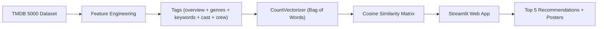

# 🎬 Movie Recommender System

A content-based movie recommendation engine built with Python and served through an interactive **Streamlit** web app. Select any movie from a catalog of **4,806 titles** and instantly get the top 5 most similar movies — complete with poster art fetched from TMDB.


---

## 📖 How It Works



1. **Data Loading** — Two CSV files (`tmdb_5000_movies.csv`, `tmdb_5000_credits.csv`) are merged on the `title` column.
2. **Feature Engineering** — Genres, keywords, top-3 cast members, director, and overview are extracted and combined into a single `tags` string per movie.
3. **Text Processing** — Tags are lowercased, spaces within multi-word names are removed (to avoid confusion), and **Porter Stemming** is applied to normalize words (e.g., *loved → love*).
4. **Vectorization** — A `CountVectorizer` (max 5,000 features, English stop-words removed) converts the tags into a Bag-of-Words matrix.
5. **Similarity** — **Cosine similarity** is computed between all movie vectors, producing a 4,806 × 4,806 similarity matrix.
6. **Recommendation** — For a selected movie, the system sorts all other movies by descending similarity and returns the top 5.
7. **Poster Fetching** — Movie posters are pulled in real-time from the [TMDB API](https://www.themoviedb.org/documentation/api).

---

## 📁 Project Structure

```
recomendation enggin/
├── app.py                          # Streamlit web application
├── recomendation_enggin.ipynb      # Jupyter notebook (data processing & model building)
├── movies.pkl                      # Serialized DataFrame (id, title, tags) — 4,806 movies
├── similarty.pkl                   # Serialized cosine similarity matrix (~176 MB)
└── README.md                       # This file
```

---

## 🛠️ Tech Stack

| Layer            | Technology                                      |
| ---------------- | ----------------------------------------------- |
| Language         | Python 3                                        |
| Web Framework    | Streamlit                                       |
| ML / NLP         | scikit-learn (`CountVectorizer`, `cosine_similarity`) |
| Stemming         | NLTK (`PorterStemmer`)                          |
| Data Handling    | Pandas, NumPy                                   |
| API              | TMDB (The Movie Database) for poster images     |
| Serialization    | Pickle                                          |

---

## 🚀 Getting Started

### Prerequisites

- Python 3.8+
- A [TMDB API key](https://www.themoviedb.org/settings/api) (one is already embedded in the code for convenience)

### Installation

```bash
# Clone the repository
git clone <repo-url>
cd "recomendation enggin"

# Install dependencies
pip install streamlit pandas numpy scikit-learn nltk requests

# Download NLTK data (if running the notebook)
python -c "import nltk; nltk.download('punkt')"
```

### Run the App

```bash
streamlit run app.py
```

The app will open in your browser at `http://localhost:8501`.

### Rebuild the Model (Optional)

If you want to retrain from scratch, place the original datasets in the project folder:
- `tmdb_5000_movies.csv`
- `tmdb_5000_credits.csv`

Then run all cells in `recomendation_enggin.ipynb`. This will regenerate `movies.pkl` and `similarty.pkl`.

---

## 🖥️ Usage

1. Open the app in your browser.
2. Select a movie from the dropdown.
3. Click **Recommend**.
4. View the top 5 similar movies with their posters.

---

## 📊 Dataset

- **Source**: [TMDB 5000 Movie Dataset](https://www.kaggle.com/datasets/tmdb/tmdb-movie-metadata) on Kaggle
- **Size**: 4,806 movies after cleaning (null/duplicate removal)
- **Features used**: `genres`, `keywords`, `overview`, `cast` (top 3), `crew` (director only)

---

## 🔑 API Note

The app uses the TMDB API to fetch movie poster images at runtime. If the embedded API key stops working, replace it in [`app.py`](file:///c:/Projects/recomendation%20enggin/app.py#L6) with your own key from [TMDB](https://www.themoviedb.org/settings/api).

---

## 📄 License

This project is open-source and available for educational purposes.

